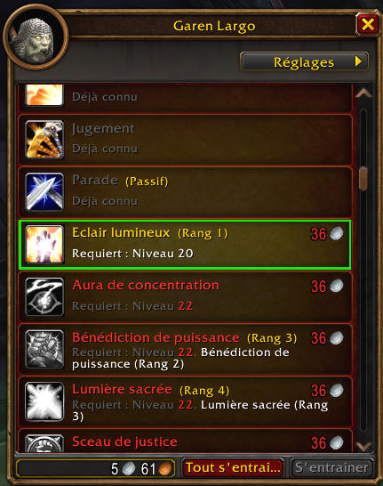
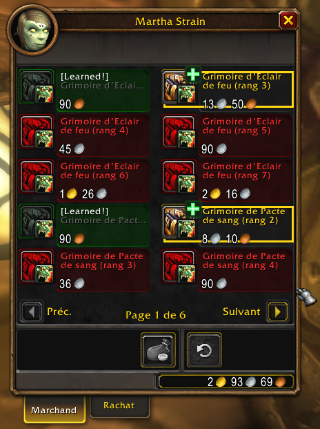
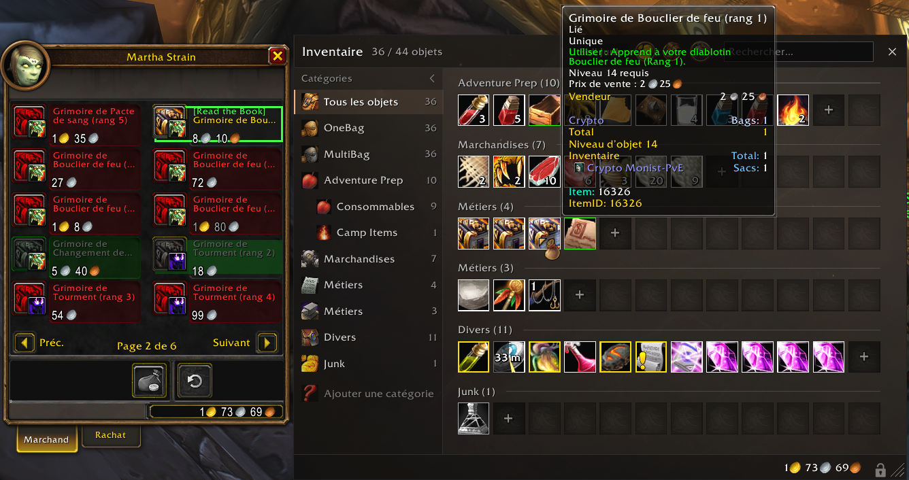

# SkillsAlreadyKnown

Small WoW Forever addon that makes class trainer spells and warlock pet grimoires easier to identify at merchants and in your inventory.

## What It Does

- Known trainer spells are shown in grey.
- Spells locked by character level are shown in red.
- Spells that can be learned now get a green outline.
- Class trainer icons show learned and learnable markers.
- Warlock pet grimoires show learned, learnable, and locked states with pet-aware markers.
- Pet grimoires already in your bags are marked with `[Already in your Bag]`, even if the related pet is not active.
- Bags, bank, and guild bank can mark known or learnable pet grimoires after the addon has identified them.
- Seen item locations are saved locally to help spot duplicates across bags, bank, and guild bank.
- Debug windows provide colored previews and clean copyable support reports for easier bug reports.

The addon uses trainer API state such as `available`, `used`, level requirements, and saved pet spell data instead of relying only on localized text.

## Preview







## Compatibility

Built for WoW Forever / Camelot:

```toc
## Interface: 16001
## AllowLoadGameType: camelot
```

### Inventory overlays

Recognized warlock pet grimoires use the same markers in your inventory as at
the merchant:

- Already learned: a darkened book overlay.
- Learnable by your active pet at its current level: a yellow outline and plus marker.
- Demon identification: the matching pet icon.

Overlays have been tested in game with **Blizzard bags** and **EllesmereUI Bags**.
EllesmereUI Bags supports overlays in grid and list views.
Other bag addons may need a dedicated integration; compatibility is not yet
confirmed. Bank and guild bank support is implemented, but has not been validated
in game yet. Stored bank locations are last-seen information,
updated when those windows are opened.

Markers refresh when books move, item information becomes available, or saved
pet spells change. Pet knowledge is based on spellbook data saved for each demon;
use the relevant pet to let the addon record its spells.

## Install

Place the folder here:

```text
World of Warcraft/_forever_/Interface/AddOns/SkillsAlreadyKnown
```

Then enable **Skills Already Known** in the in-game AddOns list and reload/restart the client.

## Commands

```text
/sak
/sak debug
```

`/sak` opens the summary window and forces a refresh.
`/sak debug` opens spellbook and class trainer diagnostics with a copyable support export.

```text
/sak pet
/sak petdebug
```

`/sak pet` shows saved pet spell information.
`/sak petdebug` opens pet grimoire diagnostics with a copyable support export.

## License

MIT
