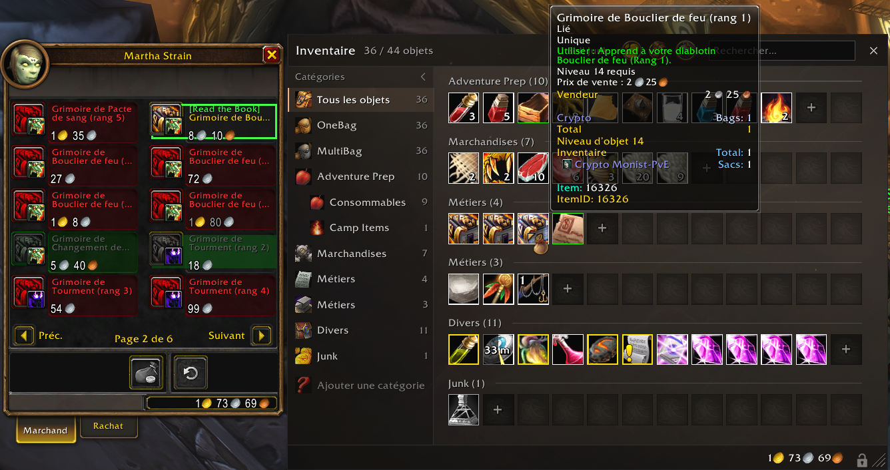

# Skills & More

By **CryptoLogiq** — spell ranks, talents, roles and smarter training for **WoW Forever**.

## Screenshots

These screenshots show an older version and will be updated.

## Learn at a glance

**NEW +** means learnable now, **✓** already learned, **NEXT** the next milestone and **NOT NOW** unavailable. Colored outlines help distinguish them at class and profession trainers.

| Marker | Meaning |
| --- | --- |
| **BEST** | Highest rank you have learned, even alone. |
| **LOW** | An older rank: you already know a higher one. |
| **BUY NEW RANK** | An accessible higher rank remains to learn. |
| **ECO** | Rank 1 can suffice for the recommended leveling use. |
| **OPTIONAL** | A spell or extra rank whose purchase can wait for your roles. |
| **CLASS** | Essential to a class mechanic, such as Drain Soul for Soul Shards. |
| **AOE** | Area damage, multiple targets or a related talent improvement. |
| **SURVIVAL** | Defensive tools, escapes, shields or emergency sustain; hover for limits. |
| **KICK / TAUNT / AGGRO** | Interrupts, forced attacks and explicit additional threat. |
| **TANK / HEAL / DPS** | Role orientation of selected forms, stances, auras and effects. |
| **RECENT** | Part of your latest recorded learning. |

Usage markers can combine. In the spellbook they sit above rank badges; OPTIONAL stays beside BEST and RECENT below the icon. Badges can also appear above spell tooltips.

**ECO saves training gold, not guaranteed mana.** OPTIONAL does not mean useless. Advice must suit every selected role; choosing PvP suspends ECO and OPTIONAL. Upgrade alerts use TrainerSpells or the trainer you have opened and do not check your gold.

## Recent learning and sparkles

Review your latest spells, pet abilities, talents and recipes in **Recent learning**. The list survives reload; an empty trainer visit keeps it, while new learning replaces it. On first use, already-known spells from your latest accessible level tier can form the initial list.

- **Gold:** a RECENT player spell is missing from action bars.
- **Blue:** it is placed but has no successful use recorded yet. The tooltip explains it; the first successful use removes blue, while RECENT stays.
- **Learning sparkles:** NEW + trainer icons and recognized unlearned recipe icons at merchants and in loot.

Blizzard and EllesmereUI action, stance, form and aura bars are supported. Inactive pages and recognized macros count as placement. Complex macros may not be detected. Usage tracking starts with this feature and survives reload.

Particles stay around icons. Sold-out merchant recipes and incomplete recipe data do not sparkle. Each effect can be toggled in **Display**.

## Roles and talent guidance

Choose roles and specializations in **Talent Spec and Role**. The first-use window proposes a choice from your talents or the solo leveling recommendation; nothing is activated until you confirm it.

Role labels and specialization summaries appear in the talent trees and spellbook. **LEVELING** marks the main solo recommendation. **PVP** and **PVE PVP** explain selected talents and spells. Before level 10, spellbook tabs also show specialization summaries.

Selected Paladin talents show **Recommended for**, with specialization icons and the exact guide build context. Situational variants are identified. This is not a complete build list, and popularity alone does not produce recommendations.

A short selection of tooltip hints explains combinations such as Judgement with a Seal, Ice Lance against a frozen target and Fire Nova with a Fire totem.

## Books and recipes

Warlock pet grimoires show learned or learnable status and demon icons at merchants and in bags. Merchants also flag books already owned. Summon each demon once to record its spells; markers then remain available whichever demon is active. A gold border highlights books for your active demon.

Pet spellbooks use BEST, LOW, BUY NEW RANK and RECENT. Upgrade alerts respect your pet’s level. **ALREADY KNOWN** marks confirmed learned recipes in bags and native loot windows. Loot choices always remain yours.

## Make it yours

Open **Options → AddOns → Skills & More** with **/sam settings** or the minimap button. Sections appear in the left-hand list.

- **Display:** icons, outlines, text, backgrounds and separate display zones.
- **Custom → Spell badges:** change usage, PvP and purchase markers, or add a spell ID. Apply to this character or the class across your account; **All ranks** defaults on. Character choices take priority.
- **Language:** automatic detection, French or English; reload after changing it.
- **Reset:** restore defaults or reopen the first-use window, with confirmation.
- **Patchnotes:** read features and fixes by version.

Settings are saved per character. The minimap launcher also works with HidingBar and Titan Panel. **/sam** opens the summary and refreshes markers.

## Compatibility and support

Bag markers are confirmed with **Blizzard bags** and **EllesmereUI Bags**. Other bag addons and custom profession windows are not confirmed.

DarkMode and TrainerSpells have dedicated handling. TrainerSpells keeps control of its trainer text; supported lists can show purchase and usage markers, RECENT and learned pet checks.

For a bug report, include the affected window, a screenshot and steps to reproduce.

[Source code](https://github.com/CryptoLogiq/SkillsAlreadyKnown) · [MIT License](https://github.com/CryptoLogiq/SkillsAlreadyKnown/blob/main/LICENSE)
