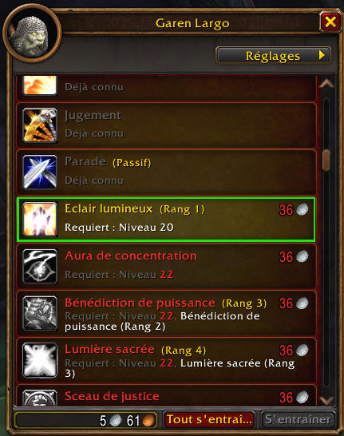
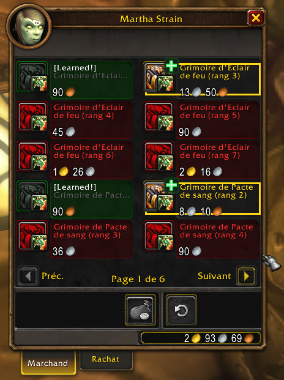

# Skills & More

By **CryptoLogiq** — spell ranks, talents, roles and smarter training for **WoW Forever**.

Previously known as Skills Already Known.

## Screenshots

These screenshots show an older version and will be updated to reflect Skills & More.

## Learn at a glance

Trainer markers show **NEW +** for learnable spells, a **green check** for learned spells, **NEXT** for the next milestone and **NOT NOW** for unavailable spells. Colored outlines make each state easy to spot; NEW + can also glow. Profession trainers highlight the next training step with NEXT.

## Understand your spell ranks

| Marker | Meaning |
| --- | --- |
| **BEST** | Highest rank you have learned, even if it is the only one. |
| **LOW** | An older rank you have already replaced. |
| **BUY NEW RANK** | An accessible higher rank remains to learn. |
| **ECO** | Rank 1 can suffice for the recommended use while leveling. |
| **OPTIONAL** | A spell or extra rank whose purchase can wait for your selected roles. |

Hover recognized spells for explanations, including on action bars. **ECO saves training gold, not guaranteed mana.** OPTIONAL does not mean useless. Advice covers selected spells, must suit every role you choose and is suspended when you select PvP. Upgrade markers use TrainerSpells or information from a trainer you have opened; they do not check your gold.

## Find what you just learned

**RECENT** marks your latest learned spells, talent ranks and recipes in supported views. The complete list is available in **Recent learning** and saved between sessions. A trainer visit without learning anything keeps the previous list; new learning replaces it.

On first use, already-known spells from your latest accessible level tier are selected when their required levels are available. Your next learning replaces this initial selection.

## Get to know your specialization

Choose roles available to your class and read specialization summaries with advantages and drawbacks. The first-use window suggests a specialization from your talents or the solo leveling recommendation. Advice becomes active only after you confirm your choices.

Role labels appear in the talent trees and spellbook. **LEVELING** identifies the main solo recommendation. **PVP** and **PVE PVP** explain the suggested use of selected talents and learnable spells. Before level 10, spellbook school tabs also show specialization summaries.

## Recognize books and recipes

Warlock pet grimoires show learned or learnable status and demon icons at merchants and in bags. Merchants also flag books you already own. Summon each demon to record its learned spells.

**ALREADY KNOWN** identifies learned recipes in bags and group or raid loot-roll windows when the game confirms them. The addon never chooses a loot roll for you.

## Make it yours

Open the options with **/sam settings** or the minimap button. Choose where icons appear and control outlines, text and backgrounds separately. Settings are saved per character. Language follows the game client by default: French for French clients, English otherwise. Choose French or English manually in Language and reload to apply. The launcher is also available through **HidingBar** and **Titan Panel**.

The options include role choices, recent learning, patchnotes, reset confirmations and support reports. Use **/sam** for the summary or **/sam conflicts** for a compatibility report.

## Compatibility and support

Bag markers are confirmed with **Blizzard bags** and **EllesmereUI Bags**. Other bag addons and custom profession windows are not confirmed; the recent-learning list remains available in the options.

DarkMode and TrainerSpells have dedicated compatibility handling. TrainerSpells keeps control of its trainer text; its class list can show purchase advice, usage markers and RECENT where space allows.

For a bug report, open the affected window, reproduce the issue and share its **Copy Export** report from Diagnostics.

[Source code](https://github.com/CryptoLogiq/SkillsAlreadyKnown) · [MIT License](https://github.com/CryptoLogiq/SkillsAlreadyKnown/blob/main/LICENSE)
